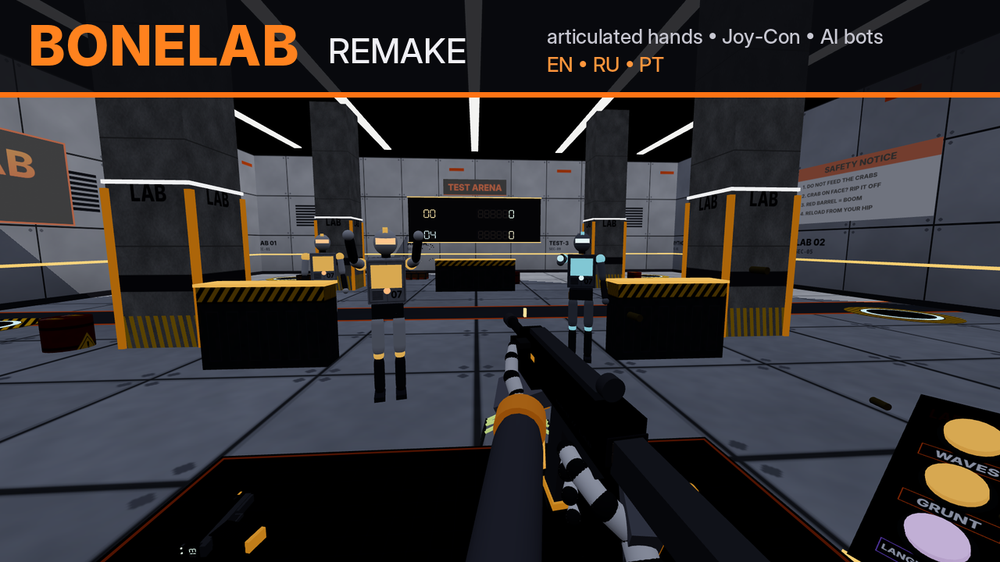

# BONELAB Remake (fan remake) — EnJoyTheMR / VR Box

Fan remake inspirado em **BONELAB**, feito para o app **EnJoyTheMR** (celular + óculos VR Box).
Escrito em **Lua puro** (`display: "scene"`), sem Unity: tudo é montado em tempo real com a `EMRAPI`.



## Instalar (.emrd)

1. Copie `dist/BoneLabRemake.emrd` para o celular.
2. Abra o arquivo com o **EnJoyTheMR** (app Arquivos → "Compartilhar"/"Abrir com" → EnJoyTheMR).
3. Confirme a instalação. O `.emrd` é o pacote de desenvolvimento, sem criptografia. Pra ir pra loja
   oficial, mande o `.zip` da pasta pro bot do Telegram (`/upload`), que gera o `.emr`.

Pra reconstruir o pacote depois de mexer no código:

```bash
python3 tools/gen_textures.py   # texturas (images/)
python3 tools/gen_sounds.py     # sons e músicas (sounds/)
python3 tools/build_emrd.py     # -> dist/BoneLabRemake.emrd
```

## Novidades da 1.1.0 (pedidas pela moderação)

- **Idiomas: English / Русский / Português.** Todos os textos e placas do cenário foram traduzidos.
  O idioma inicial segue o teclado da plataforma, e dá pra trocar no botão **IDIOMA/LANGUAGE/ЯЗЫК**
  do console ou no painel.
- **Pegar ficou bem mais fácil e nada escorrega mais da mão:**
  - pra soltar, a mão tem que ficar *claramente aberta* por um instante; tremida do tracking não derruba;
  - se o tracking perde a mão, o item continua segurado;
  - raio de pega 50% maior, e apertar "pegar" um pouco antes de encostar também pega;
  - **puxar à distância** (force grab, como no BONELAB): aponte a palma pra arma até 3 m e feche a mão;
  - opção **"Pegar alternado"**: fecha uma vez pra pegar e o item fica na mão até fechar de novo.
  - No teste com tracking ruim (tremor + perda da mão), a 1.0 deixou a arma cair 6 vezes e a 1.1, nenhuma.

## O que tem

- **Mão fake articulada**: as 21 articulações do hand tracking viram uma mão de manequim/robô, com
  falanges, juntas metálicas, palma com placa de armadura, bracelete e antebraço. O esqueleto padrão
  da plataforma fica escondido.
- **Mãos integradas às armas**: ao segurar, os dedos encaixam no cabo (pose de empunhadura), o
  indicador puxa o gatilho de verdade, a mão de apoio segura o guarda-mão e a mão recua junto com a arma.
- **Joy-Con** (Bluetooth) **ou gestos**. Funciona dos dois jeitos e troca sozinho.
- **Armas**: Pistola, SMG (automática, duas mãos), Escopeta (bomba com a mão de apoio) e Taco.
  Cada arma tem contador de munição no próprio modelo, pente físico, ferrolho que trava no último
  tiro, cápsulas ejetadas, traçantes, flash, faíscas e marcas de bala.
- **Recarga estilo BONELAB**: solte o pente, leve a mão livre até a **bolsa no quadril**, feche a
  mão e encaixe o pente novo embaixo da arma.
- **Bots com IA**:
  - **Grunt**: corre até você e ataca corpo a corpo.
  - **Atirador**: mantém distância, procura linha de visão e dispara plasma (dá pra desviar,
    abater no ar ou rebater com o taco).
  - **Crab**: pula no seu rosto! Feche a mão nele e arremesse, ou dê um soco.
  - **Boneco de treino** no laboratório.
  - Dano por parte do corpo (headshot ×2,6), reação a golpes, desvio de obstáculos e **ragdoll** na morte.
- **Física**: caixas e barris com Rigidbody de verdade (empurrar, atirar, arremessar). Os barris
  vermelhos explodem e causam reação em cadeia.
- **Modos**: Laboratório (treino), **ONDAS** (dificuldade crescente, combo, recorde salvo) e
  **SANDBOX** (munição infinita, você cria os inimigos).
- **Socos**: mão livre em alta velocidade causa dano.
- Placar de 7 segmentos na parede, relógio de vida no pulso esquerdo, borda vermelha ao tomar dano,
  música do laboratório e música de combate, todos os sons sintetizados.

## Controles

| Ação | Joy-Con | Gestos (sem controle) |
|---|---|---|
| Pegar / segurar | **R / L** | fechar médio + anelar + mindinho |
| Puxar à distância | apontar a palma + **R / L** | apontar a palma + fechar a mão inteira |
| Soltar / arremessar | soltar R / L | abrir bem a mão (ou fechar de novo, no modo alternado) |
| Atirar | **ZR / ZL** | dobrar o indicador |
| Soltar o pente | **A** | atirar sem munição (o pente vazio cai sozinho) |
| Pente novo | mão livre na bolsa do quadril + pegar | igual |
| Andar | analógico | mão esquerda **apontando** (indicador esticado) |
| Virar 45° | X / Y (após calibrar) | virar o corpo |
| Menu | − | painel de UI |

Na primeira vez com Joy-Con, aperte o botão **JOY-CON** no console do lab e siga as instruções:
o jogo pede cada botão e salva o mapeamento.

**Console do laboratório** (aperte os botões com o dedo): ONDAS, SANDBOX, LAB, JOY-CON, GRUNT,
ATIRADOR, CRAB, LIMPAR, IDIOMA.

**Painel de configurações**: idioma, mira assistida, andar com gesto, ver o quarto (modo MR com a câmera),
virar suave, pegar alternado, altura, velocidade e volume da música.

## Estrutura

```
app.json            manifesto (scene, lua, API 2)
scripts/main.lua    ciclo de vida e laço principal
scripts/vec.lua     matemática (vetores, bases, Euler da Unity, raycast)
scripts/api.lua     camada segura sobre a EMRAPI (pcall, materiais, Rigidbody)
scripts/rig.lua     jogador: o MUNDO se move na locomoção (a câmera do celular não se move)
scripts/controls.lua Joy-Con + gestos + calibração
scripts/hands.lua   a mão fake articulada
scripts/poses.lua   poses da mão em cada arma
scripts/items.lua   pegar, soltar, arremessar, recarregar, mesa de armas
scripts/weapons.lua armas (modelos, tiro, recuo, pente, bomba, taco)
scripts/bots.lua    IA, animação procedural, dano por parte, ragdoll, projéteis
scripts/props.lua   caixas e barris com física real
scripts/combat.lua  raycast unificado, dano e explosões
scripts/player.lua  vida, dano, relógio de pulso, socos
scripts/game.lua    modos, ondas, placar, console 3D, mensagens, menu
scripts/i18n.lua    traduções EN / RU / PT
tools/              geradores de textura/som, empacotador e simulador de testes
```

## Testes (fora do celular)

`tools/run_sim.py` roda o jogo inteiro num **EMRAPI falso** (Lua 5.3 via `lupa`), com mãos e
Joy-Con sintéticos, e falha se houver erro Lua ou variável global vazando:

```bash
pip install lupa
python3 tools/run_sim.py --scenario smoke    # pega pistola, atira, ondas, recarrega pela bolsa
python3 tools/run_sim.py --scenario joycon   # calibra, anda, vira, pega e atira com botões
python3 tools/run_sim.py --scenario crab     # crab pula no rosto, você arranca e arremessa
python3 tools/run_sim.py --scenario idle --seconds 90   # bots matam o jogador -> fim de jogo
python3 tools/run_sim.py --scenario smoke --nocs        # plataforma sem acesso a CS.*
python3 tools/run_sim.py --scenario jitter              # segurar arma com tracking ruim: não pode cair
python3 tools/run_sim.py --scenario smoke --lang ru     # roda em russo (en / ru / pt)
```

`tools/render_scene.js` renderiza os snapshots (`--snap`) com three.js para conferir o visual.

## Limitações honestas

- Ainda **não foi testado num celular de verdade**, só no simulador. Os pontos que dependem da
  plataforma estão protegidos com `pcall` e têm alternativa:
  - **Joy-Con**: a EMRAPI oficial não tem controles. O jogo lê o gamepad direto pela Unity
    (`CS.UnityEngine.Input`). Se a plataforma bloquear, tudo continua funcionando por gestos.
  - **Brilho/metal dos materiais e impulso nos objetos** usam a Unity direto. Se bloqueado, os
    objetos ficam foscos e os ragdolls caem sem impulso.
  - O analógico usa os eixos padrão `Horizontal`/`Vertical`. Se não responder, calibre um botão de
    "ANDAR" ou use o gesto de apontar.
- Os gráficos são montados com primitivos (cubos, cápsulas, esferas), texturas procedurais e
  emissão. Não dá pra igualar o BONELAB de PC/Quest num app Lua de celular.
- Projeto de fã, sem relação com a Stress Level Zero. Não contém nenhum asset do jogo original.
