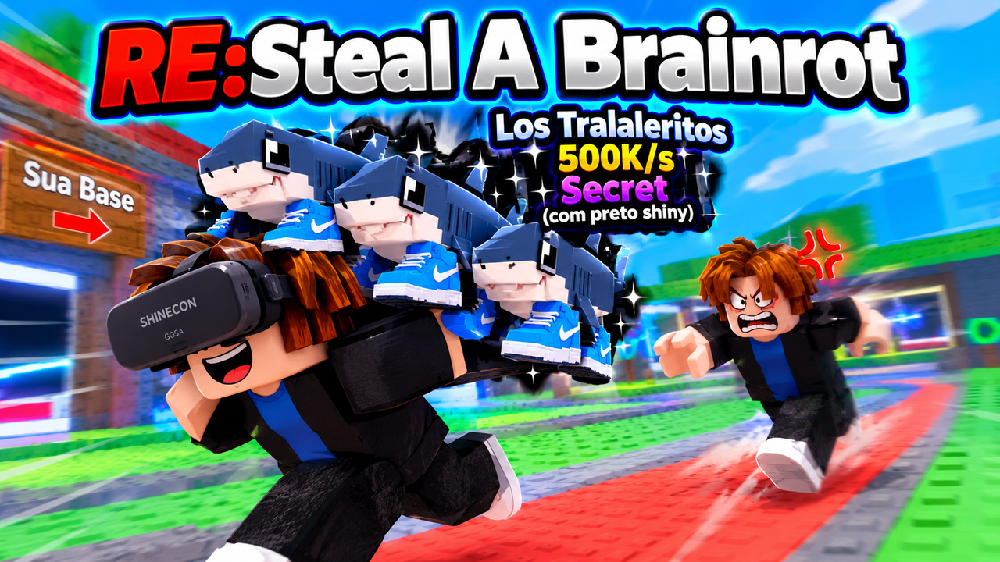

# RE:Steal A Brainrot VR — EnJoyTheMR / VR Box

O **Steal a Brainrot** em realidade virtual, **só online** (até 8 jogadores por sala, sem bots), feito para o app **EnJoyTheMR** (celular + óculos VR Box).
Escrito em **Lua puro** (`display: "scene"`): mapa, brainrots, avatares e interface são montados em
tempo real com a `EMRAPI`.



## Como se joga

1. Você começa com **$200** numa base com 10 vagas.
2. Na **esteira vermelha** do meio passam brainrots **italianos**. Chegue perto, olhe pra ele e
   **segure R** (ou feche a mão) para **comprar**. Ele vai andando sozinho para a sua base.
3. Cada brainrot gera **$/s**. O dinheiro acumula na **placa verde** da vaga: **pise nela** (ou
   encoste a mão) para coletar.
4. **Roube!** Entre na base de outro jogador, olhe para um brainrot e **segure R por 5 segundos**.
   Ele vai para cima da sua cabeça. **Corra para a sua base** (a seta verde mostra o caminho).
   Carregando, você fica mais lento. Se levar uma tacada, o brainrot volta para o dono.
5. **Defenda:** bata nos ladrões com o **taco (ZR)** e pise no **botão vermelho** da sua base para
   trancá-la: **lasers** bloqueiam a porta por 60 s.
6. Venda brainrots (olhe para um seu e segure R por 3 s), compre itens na **loja** e **renasça**
   (altar roxo no fim da esteira) para multiplicar o dinheiro.

## O que tem

- **56 brainrots italianos**, baseados na wiki do Steal a Brainrot, de **Noobini Pizzanini** até
  **Dragon Cannelloni**. Todos são modelados com peças 3D e estão em 7 raridades: Common, Rare, Epic,
  Legendary, Mythic, Brainrot God e Secret. Cada um **fala o próprio nome em italiano** (voz TTS).
- **Mutações:** Gold x1.25, Diamond x1.5, Halloween x3, Candy x4, Lava x6 e Rainbow x10. Cada uma
  tem visual próprio.
- **Eventos com boosts:**
  - **Noite = Halloween:** abóboras, morcegos, céu estrelado. Sorte x2 e mutação Halloween.
  - **Candy** (aleatório): chuva de doces. Pegar dá dinheiro e corrida doce. Dinheiro x2 e mutação
    Candy.
  - **Lava** (raro): céu vermelho e meteoros caindo, fuja do círculo! Sorte x3 e mutação Lava.
- **Anúncios** quando aparece um Brainrot God ou Secret na esteira.
- **Itens da loja:** Taco (grátis), Mão de Tapa (empurra longe), Mola de Velocidade, Armadilha (x3)
  e Capa da Invisibilidade.
- **Só online** (Photon, até 8 jogadores por sala). O jogo conecta sozinho ao abrir e reconecta se cair.
  O menu tem **Reconectar / outra sala**.
- **Avatares Bacon Hair e Acorn Girl** (estilo Roblox R6), com animação de andar, carregar, bater e
  ficar tonto. Suas mãos usam a pele e a manga do avatar.
- **Placar** dos mais ricos, **renda offline** (metade do que os brainrots fariam enquanto você
  estava fora, até 3 h) e progresso salvo.
- **Idiomas:** English (padrão), Русский e Português.

## Controles (Joy-Con)

| Ação | Joy-Con | Sem controle (mãos) |
|---|---|---|
| Andar | **analógico** | mão esquerda apontando |
| Virar | analógico direito (Input System) ou X/Y após calibrar | virar o corpo |
| Comprar / roubar / vender / interagir | **segurar R ou L** | fechar a mão |
| Bater / usar item | **ZR** | balançar a mão com o taco |
| Trocar item | **ZL** | (menu) |
| Pular | **A** (ou seta para baixo) | — |
| Menu | **−** | palma esquerda virada para o rosto por 1 s |

Na primeira vez, use **Calibrar Joy-Con** no menu: o jogo pede cada botão e salva o mapeamento.

## Online (Photon)

O multiplayer usa o `EMRAPI.Multiplayer` (Photon Realtime). Para funcionar, o app precisa de um
**Photon App ID** (grátis):

1. Crie uma conta em **dashboard.photonengine.com**.
2. Clique em **Create a New App** e escolha o tipo **Realtime**.
3. Copie o **App ID** e coloque em `app.json`: `"photonAppId": "SEU-ID"`.
4. (Opcional, para o chat de voz) crie um segundo app do tipo **Voice** e coloque o ID em
   `"photonVoiceAppId"`.

O App ID deste projeto já está no `app.json`.

## Instalar / publicar

- `dist/StealABrainrotVR.emrd`: abra com o EnJoyTheMR para instalar direto.
- `dist/StealABrainrotVR.zip`: mande para o bot do Telegram (`/upload`) para gerar o `.emr` da
  loja. Opções: **Cena**, **Lua**, entrada `scripts/main.lua`, ícone `icon.png`, preview
  `preview.png`.

Para reconstruir o pacote:

```bash
python3 tools/gen_textures.py                        # images/ (EN/RU/PT, letras, placas, céu...)
PIPER_VOICES=pasta/com/vozes python3 tools/gen_sounds.py   # sounds/ (efeitos, músicas, vozes)
python3 tools/build_emrd.py                          # dist/StealABrainrotVR.emrd
```

As vozes usam o [Piper](https://github.com/rhasspy/piper) com os modelos `it_IT-riccardo-x_low` e
`it_IT-paola-medium` (os `.onnx` não ficam no repositório; sem eles, as vozes já geradas são mantidas).

## Estrutura

```
scripts/main.lua      ciclo de vida, locomoção, laço principal
scripts/game.lua      regras (comprar/roubar/entregar/bater), rede, loja, renascer, tutorial, salvar, menu
scripts/catalog.lua   os 56 brainrots, raridades, mutações, sorteio
scripts/models.lua    modelos 3D dos brainrots + mutações + animação
scripts/world.lua     mapa: céu, esteira, 8 bases, loja, altar, placar, decoração
scripts/layout.lua    geometria do mapa (vagas, portas, caminhos)
scripts/bases.lua     vagas, renda, placas de coletar, trava com laser, LOD
scripts/conveyor.lua  esteira: sorteio, compra, brainrot andando até a base
scripts/ents.lua      personagens (você e os jogadores online), carregar, pancada
scripts/avatars.lua   avatares Bacon Hair / Acorn Girl (R6)
scripts/player.lua    jogador local: itens, golpes, pulo, coletar, trancar, doces
scripts/events.lua    dia/noite, Halloween, Candy, Lava, boosts, músicas
scripts/prompts.lua   "segure para interagir"
scripts/labels.lua, hud.lua, text3d.lua, fx.lua   interface 3D e efeitos
scripts/net.lua       camada Photon (online)
scripts/rig.lua, controls.lua, hands.lua, poses.lua, vec.lua, api.lua, i18n.lua   motor (VR, Joy-Con, mãos)
tools/                geradores, empacotador, simulador e testes
```

## Testes (fora do celular)

```bash
python3 tools/run_sim.py --scenario smoke --seconds 150    # sala com 1 jogador: compra, coleta, eventos, tranca
python3 tools/run_sim.py --scenario smoke --lang ru --nocs # russo e sem acesso a CS.*
python3 tools/run_mp.py 70                                 # ONLINE: 2 clientes num Photon falso
python3 tools/run_mp.py 75 60                              # idem, e o cliente 2 sai da sala aos 60 s
```

O `run_mp.py` sobe dois jogos completos que trocam mensagens. O cliente 2 entra na sala, rouba um
brainrot da base do mestre e leva para casa. No fim, o teste confere se a esteira e as 8 bases
estão iguais nos dois.

## Limitações

- Testado só no simulador, ainda não num celular de verdade. O desempenho depende do aparelho:
  são ~3300 objetos, com LOD para as bases longe.
- Joy-Con via `CS.UnityEngine.Input` / Input System. Se a plataforma bloquear `CS.*`, o jogo usa
  os gestos das mãos. Textos sem shader unlit ficam com fundo escuro.
- O online precisa do Photon App ID (veja acima).
- Fan game sem fins lucrativos, inspirado no jogo de Roblox "Steal a Brainrot" e nos memes
  italianos.
