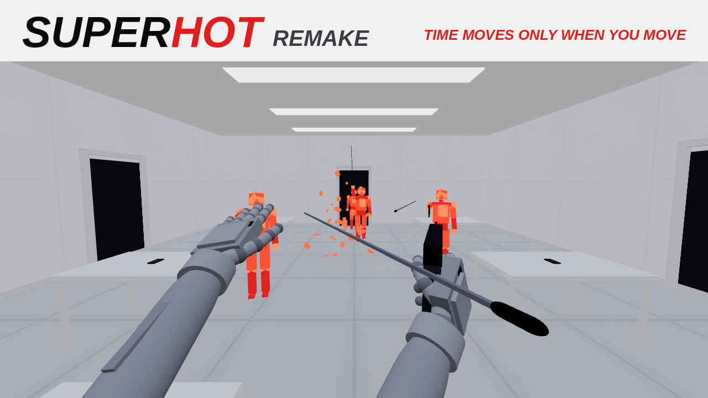

# SUPERHOT Remake (fan remake) — EnJoyTheMR / VR Box

Fan remake inspirado em **SUPERHOT VR**, feito para o app **EnJoyTheMR** (celular + óculos VR Box).
Escrito em **Lua puro** (`display: "scene"`), sem Unity: tudo é montado em tempo real com a `EMRAPI`.

**O TEMPO SÓ ANDA QUANDO VOCÊ SE MEXE.**



## Instalar (.emrd)

1. Copie `dist/SuperHotRemake.emrd` para o celular.
2. Abra com o **EnJoyTheMR** (Arquivos → "Compartilhar"/"Abrir com" → EnJoyTheMR) e confirme.
3. Para a loja: mande `dist/SuperHotRemake.zip` pro bot do Telegram (`/upload`): tipo **Cena**,
   **Lua**, entrada `scripts/main.lua`, ícone `icon.png` (256×256), preview `preview.png` (16:9).

Reconstruir depois de mexer no código:

```bash
python3 tools/gen_textures.py   # texturas e placas traduzidas (images/)
python3 tools/gen_sounds.py     # tiros, cristal quebrando, voz "SUPER HOT", ambiente (sounds/)
python3 tools/build_emrd.py     # -> dist/SuperHotRemake.emrd
```

## O que tem

- **Tempo que segue você**: parado, o mundo anda a ~5% da velocidade; mexer a cabeça, as mãos,
  virar ou andar acelera tudo até 100%. Atirar e arremessar dão um "pulso" de tempo. Até o som
  fica grave e lento.
- **Balas lentas e visíveis** com rastro: dá pra desviar, cortar com a katana, bloquear com
  um objeto na mão ou acertar uma bala com outra.
- **Inimigos de cristal vermelho** que se estilhaçam em dezenas de cacos (que ficam flutuando no
  tempo lento). IA com pistola, uzi (rajada), escopeta, katana ou soco; eles miram, se espalham,
  desviam de obstáculos, cambaleiam quando levam objeto na cara e acertam uns aos outros.
- **Sem recarga**: arma vazia é pra **arremessar**. Objeto arremessado desarma, derruba e quebra
  inimigos. Dá pra **arrancar a arma da mão** do inimigo e pegar armas no ar.
- **Armas**: pistola, escopeta (7 chumbos, guarda-mão pra segunda mão), uzi automática, katana,
  garrafa (quebra), cinzeiro, celular. **Socos** também quebram inimigos.
- **Morte com 1 tiro**, recomeço rápido da fase.
- **10 fases**: bar, elevador, escritório, corredor, dojo, metrô, galeria, estacionamento, sala
  de servidores e o núcleo. Ao vencer: **SUPER. HOT. SUPER. HOT.** com voz e letras 3D.
- **Modo INFINITO** (ondas cada vez maiores, recorde salvo) e **lobby** com cubos pra escolher
  a fase: você escolhe **quebrando o cubo** com a mão.
- **Mãos fake articuladas** (21 articulações do hand tracking), dedos encaixando no cabo das
  armas, recuo na mão.
- **Joy-Con ou gestos**, com calibração dos botões.
- **Idiomas**: English (padrão) / Русский / Português, incluindo as placas do cenário.

## Controles

| Ação | Joy-Con | Gestos |
|---|---|---|
| Pegar / segurar | **R / L** | fechar médio + anelar + mindinho |
| Puxar à distância | apontar a palma + **R / L** | apontar a palma + fechar a mão |
| Soltar / arremessar | soltar R / L com o braço em movimento | abrir a mão no meio do movimento |
| Atirar | **ZR / ZL** | dobrar o indicador |
| Socar | mão vazia rápida | igual |
| Andar | analógico | mão esquerda apontando |
| Menu | − | painel de UI |

**Painel**: lobby, reiniciar fase, infinito, calibrar Joy-Con, idioma, mira assistida, pegar
alternado, andar com gesto, altura, velocidade, volume do ambiente, recentralizar, modo MR (ver o quarto), virar suave.

## Estrutura

```
scripts/main.lua     ciclo de vida, laço principal
scripts/timeflow.lua o tempo que segue o movimento
scripts/bullets.lua  balas lentas, colisões, corte e bloqueio
scripts/enemies.lua  homens de cristal, IA, estilhaçar, desarmar
scripts/items.lua    pegar, arremessar, física em tempo de jogo, roubar armas
scripts/weapons.lua  modelos e tiro das armas, katana
scripts/fx.lua       cacos, faíscas, flash, marcas de bala, aparição dos inimigos
scripts/level.lua    salas brancas a partir de dados
scripts/levels.lua   as 10 fases e o modo infinito
scripts/game.lua     lobby, fases, ondas, SUPER HOT, menu, mensagens
scripts/player.lua   morte, socos, bloqueio
scripts/rig.lua, controls.lua, hands.lua, poses.lua, vec.lua, api.lua, i18n.lua
tools/               geradores de textura/som, empacotador, simulador e cenários de teste
```

## Testes (fora do celular)

`tools/run_sim.py` roda o jogo num mock da EMRAPI (Lua 5.3, globais estritas, checagem de
assets) com um "jogador robô":

```bash
python3 tools/run_sim.py --scenario smoke --seconds 30
python3 tools/run_sim.py --scenario still --seconds 12      # parado: 10 s reais = 0,72 s de jogo
python3 tools/run_sim.py --scenario katana --seconds 15
python3 tools/run_sim.py --scenario endless --seconds 60
python3 tools/run_sim.py --scenario campaign --seconds 200  # fases 1-5
python3 tools/run_sim.py --scenario campaign6 --seconds 260 # fases 6-10
python3 tools/run_sim.py --scenario smoke --lang ru --nocs  # russo, sem acesso a CS.*
```

Todos passam. `--snap` exporta a cena pra renderizar com `tools/render_scene.js` (three.js).

## Limitações

- Não foi testado num celular de verdade, só no simulador; desempenho depende do aparelho.
- Joy-Con usa `CS.UnityEngine.Input`; se a plataforma bloquear `CS.*`, o jogo cai pros gestos.
- Gráficos feitos só com primitivas (cubos/cilindros) + texturas geradas, no estilo minimalista
  branco/vermelho do SUPERHOT.
- Fan remake sem fins lucrativos; SUPERHOT é marca da SUPERHOT Team.
